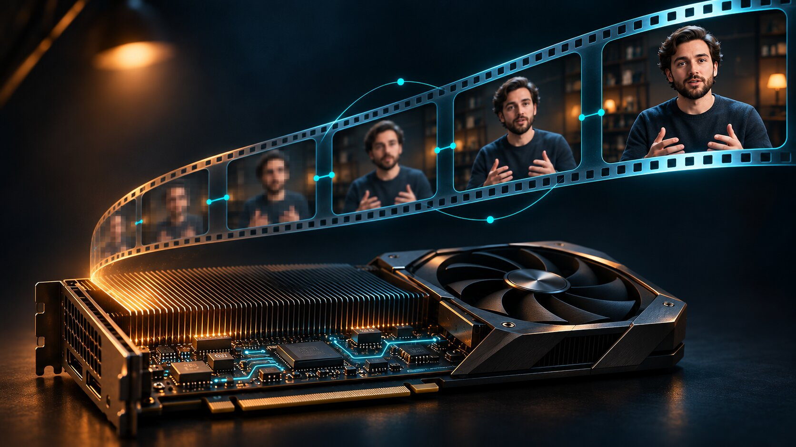
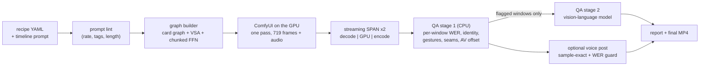

# onegpu-longvideo

Long one-shot talking-head and cinematic video, with native speech and sound, on one consumer GPU.
It drives a joint audio-video diffusion transformer (the MiniMax-H3 / FastH3 Omni family) through ComfyUI,
renders 30 s in a single pass, upscales to 1080p with a streaming SPAN x2 model, and checks the result with a two-stage QA.

All videos here are AI-generated and all people in them are invented. Flagship demo (170.6 s, AI presenter with an animated deck): [media/presenter.mp4](media/presenter.mp4), also first on the site.

Watch the samples: **https://modimorph.github.io/onegpu-longvideo/**

| Sample | What | Settings | Measured on our GPU |
|---|---|---|---|
| [podcast.mp4](media/podcast.mp4) | invented podcast host, 30 s, native speech, slow push-in, voice post kept | 768x432, VSA 10 %, 8 steps, seed 7329, then SPAN x2 to 1080p, then Seed-VC | render 163 s + upscale 9.4 s + voice 16 s (GPU); per-window WER 0 % in all six 5 s windows; speaker match 0.616 to 0.789 |
| [tutor.mp4](media/tutor.mp4) | invented tutor explains attention, 30 s, native speech, converted voice chosen by a listening test | 1280x720, VSA 10 %, 8 steps, seed 7330, then SPAN x2 to 1080p, then Seed-VC to a stock male voice | render 547 s + upscale 20 s + voice on CPU; per-window WER 0 % in all six 5 s windows; lip offset within 1 frame |
| [potter.mp4](media/potter.mp4) | craft documentary, one continuous crane-down shot, no speech | 1280x720, VSA 10 %, then SPAN x2 to 1080p | render 541.5 s + upscale 20.0 s |

All people in the samples are invented. Our runs used one 24 GB consumer GPU (an RTX 4090) on Windows with ComfyUI 0.41.
These are our observations, not requirements. Numbers are n = 1 unless stated. See [docs/EXPERIMENTS.md](docs/EXPERIMENTS.md).

## Required flow

Every video follows the same 12 steps: script, prompt, assets, recipe, render, best of several seeds, first QA pass, upscale, edit, voice, finish, final QA.
Each step has a pass gate. Start from `configs/flow.default.yaml`, tick [docs/FLOW-CHECKLIST.md](docs/FLOW-CHECKLIST.md) per video, and run `olv flow-check <run folder>` at the end.
Steps the repo cannot run yet are marked manual. Full flow: **[docs/FLOW.md](docs/FLOW.md)**.
A planner wraps steps 1-2 (`olv plan`: the whole script first, then one prompt per clip) and an editor wraps steps 9, 11 and 12 (`olv edit`: word check, cuts, colour match, -14 LUFS, 7x6 contact sheet). Both follow a scenario profile: talking head, tutorial, podcast, cinematic short, ad or documentary. See [docs/PLANNER.md](docs/PLANNER.md) and [docs/EDITOR.md](docs/EDITOR.md).

## How it works



- **Card graph**: the sampler setup from the model card (Euler, 8 steps, guidance 1 with `BasicGuider`, sigma shift 12 video / 3 audio). Against our older graph (guidance 0.9, two LoRAs) it cut a 10 s 1024x576 clip from about 285 s to 141-167 s, with slightly better look and voice scores.
- **VSA sparse attention** (ComfyUI `BlockSparseAttention`, keep 10 %): only video query rows go sparse; text, reference and audio rows stay dense. 3.4x faster than dense in our A/B, and speech got better, not worse.
- **Chunked FFN** (`comfyui_nodes/onegpu_nodes.py`): runs the wide MLP in token chunks to cut peak memory, so 719 frames fit without spilling into shared memory.
- **One pass, not a chain**: chained segments showed colour steps, identity dips and drops to silence at each join, so the samples are single passes. Past about 15 s, speech can break (see Limitations).
- **Streaming upscale**: decode, model and encode overlap in three threads; a 30 s 1080p upscale took 9-20 s.

## Quickstart

```bash
git clone https://github.com/modimorph/onegpu-longvideo && cd onegpu-longvideo
pip install -e ".[dev]"          # pure-Python parts; tests run on CPU
pytest -q                        # 132 tests, no GPU (the editor tests need ffmpeg)

olv graph configs/talking_head_30s.yaml --out graph.json   # build the ComfyUI API graph (no GPU)
olv lint configs/prompts/podcast_host.txt                  # check a prompt
olv plan configs/scripts/example_talking_head.yaml --profile talking_head --out plan/   # whole-film plan + prompts
olv profiles                                               # talking_head, tutorial, podcast, cinematic_short, ad, documentary, variants
```

To render you need a ComfyUI install with the MiniMax-H3 nodes and your own model weights:

1. Get the weights yourself and accept each licence (see "Models and licences"). File names go in the recipe under `models:`.
2. Copy `comfyui_nodes/onegpu_nodes.py` and `comfyui_nodes/onegpu_upscale.py` into `ComfyUI/custom_nodes/` and restart ComfyUI (or set `ffn_chunk_tokens: 0` and `upscale_in_graph: false`).
3. Start ComfyUI with the flags in `configs/comfyui_flags.txt` (`--fast fp16_accumulation`; `tools/pc/serve_comfy.ps1` does it on Windows). The default video VAE is the int8 decoder `minimax_h3_video_vae_int8_convrot.safetensors` (ComfyUI >= 0.36); set `models: {video_vae: minimax_h3_video_vae_fp16.safetensors}` if you only have the fp16 file. With `upscale_in_graph: true` (default) `olv render` writes `<name>_1080p.mp4` and `<name>_raw.mp4`, so the `olv upscale` line below is only for `upscale_in_graph: false`. Then:

```bash
export COMFY_URL=http://127.0.0.1:8188
olv render configs/talking_head_30s.yaml --out-dir out/
pip install -e ".[gpu]"
olv upscale out/podcast_host_raw.mp4 out/podcast_host_1080p.mp4 path/to/2xNomosUni_span_multijpg.safetensors
pip install -e ".[qa]"
olv wer out/podcast_host_1080p.wav configs/prompts/podcast_host.lines.txt   # 16 kHz mono wav from ffmpeg
olv camera out/podcast_host_1080p.mp4 --plan push
```

## Configuration

A recipe is one YAML file; every field maps to `onegpu_longvideo.recipe.Recipe`.

| File | Use |
|---|---|
| `configs/talking_head_30s.yaml` | podcast sample settings |
| `configs/tutor_30s.yaml` | tutor sample settings |
| `configs/documentary.yaml` | potter sample settings (720p, no speech) |
| `configs/cinematic.yaml` | an invented action street scene, sound effects only (not one of the published samples) |
| `configs/flow.default.yaml` | the required flow (steps 4-5): 1280x720, 719 frames, seed 7329 |
| `configs/voice_post.example.yaml` | optional voice conversion with the guards (method: [docs/VOICE.md](docs/VOICE.md)) |
| `configs/prompts/*.txt` | the exact prompts; `*.lines.txt` are the intended lines for WER |

Prompt rules that mattered in our runs: continuous speech with no planned silence (the model fills silence with invented words), about 2.8-3.1 words per second, one new one-hand gesture per line, a time-coded camera plan, no trailing space before `</d>`.

## Package map

| Module | What |
|---|---|
| `frames` | 17k+5 frame rule, latent and token counts, temporal RoPE periods, windows |
| `prompt` | timeline prompt builder and linter |
| `recipe` | YAML recipe dataclass |
| `workflow` | ComfyUI graph builder (card graph, LoRA chain, VSA, chunked FFN, video guide for chains), graph validator |
| `comfy` | ComfyUI HTTP client; reads ComfyUI's own execution time |
| `upscale` | streaming SPAN (spandrel) upscaler with NVENC or x264 |
| `qa.wer` | per-window WER with error map (wrong, invented, missing) |
| `qa.detectors` | identity drift and jumps, seams, gesture repeats, AV offset, stage-2 window merging |
| `qa.stage2` | vision-language model check on flagged windows (any OpenAI-compatible endpoint) |
| `voice` | voice post: sample-exact length, envelope lag per window, WER guard |
| `camera` | camera-path estimate and plan check |
| `flow` | `olv flow-check`: validate a run folder against the flow gates |
| `planner` | `olv plan`: text pass, fact sheet, speech density, angle plan, gesture budget, colour anchor, prompts per clip; `olv calibrate`: measured speaking rate vs the plan |
| `editor` | `olv edit`: word check after cuts, cut list, keyframed colour match per set-up, sample-exact joins, captions, loudness, contact sheet, QA gates |
| `colour` | Lab statistics, Reinhard transfer as a 3D LUT, dE76 |
| `profiles` | scenario profiles (`configs/profiles/*.yaml`) merged over the base |
| `timing` | stage timing log, GPU memory sampler, torch profiler helper |

## What we tried and what happened

Native-code results (1.17-1.19x, not 2x): [docs/NATIVE.md](docs/NATIVE.md). Short version; the full tables are in [docs/EXPERIMENTS.md](docs/EXPERIMENTS.md) and [docs/PERFORMANCE.md](docs/PERFORMANCE.md).

- **Route to 30 s at 1080p**: native 1080p did not fit (activations about 31 GB, estimated). 720p + VSA + streaming SPAN x2 took 12.7 min end to end (762 s), measured.
- **Attention**: VSA keep 10 % was 3.4x faster than dense. Sage on video rows only was 1.44x. `torch.compile` failed at step 1.
- **Resolution vs time at 30 s**: before VSA, 768x432 took about 504-515 s and 1024x576 took 1313 s; with VSA, 768x432 took 163 s.
- **Length**: 30 s worked with prompt discipline. 45 s and 60 s single passes filled with invented words (60 s: WER 0.495 and 1.62 on two tries).
- **Chaining** five 13 s segments with a video guide: 447 s for 60 s, WER 6 %, but colour steps, identity dips and silence at every join. Dropped.
- **Identity LoRA**: we trained a single-identity LoRA on consented data in rounds; what helped and what did not is in EXPERIMENTS.md section 7. No weights or data ship here.
- **Voice post** (Seed-VC): both published samples now use a converted voice. The tutor's first conversion passed every metric but a listener rejected it. We then diagnosed the voice (thin low end, 1-3 kHz honk, narrow pitch range), tried five labelled candidates at equal loudness, and a listening A/B picked a conversion to a livelier stock male voice (pitch range 6.9 to 12.3 semitones, WER 0 in all windows). The method is in [docs/VOICE.md](docs/VOICE.md).
- **Temporal RoPE stretch** (to push past the trained 15 s): made speech much worse.

## Limitations

- Speech past about 15 s: every speech error we measured at 30 s started at 14.5 s or later. One seed passes, the next can fail. Generate 2+ takes and pick by per-window WER.
- Two-hand gestures cross and fuse; we avoid props that change state in talking-head prompts.
- QA stage 2 is built but not scored against a labelled set.
- Results come from one GPU model and one OS; other setups are untested.
More in [docs/LIMITATIONS.md](docs/LIMITATIONS.md) and [docs/QA.md](docs/QA.md).

## Models and licences

This repository is Apache-2.0 and ships **no model weights**. You bring your own weights and must accept each model's licence:
the MiniMax-H3 / FastH3 family (its licence has **territory limits**: read it before use), the realism LoRA, the text encoder,
the SPAN upscaler weights, faster-whisper, Seed-VC and any face or pose model you use for QA.
Only generate a real person's likeness or voice with that person's written consent.

## Connect your coding agent

Point your agent (Claude Code, Codex, or similar) at this README and these entry points:

1. Read `AGENTS.md` for the rules of this repo, then `docs/EXPERIMENTS.md` for what already failed.
2. `pytest -q` must pass before and after a change. CI runs `ruff check src tests` and `pytest` on CPU.
3. Change a render by editing a recipe YAML, not code. Build the graph with `olv graph` and inspect it before a GPU run.
4. Measure, then claim: every speed or quality claim needs the command and its output (`timings.jsonl`, `olv wer` JSON).
5. One GPU job at a time. Two renders at once were 3.5x slower on our card.

## Contributing

See [CONTRIBUTING.md](CONTRIBUTING.md). Experiments with numbers are as welcome as code.
