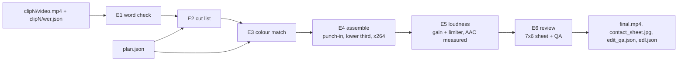

# Editor (`olv edit`, flow steps 9, 11, 12)

The editor turns rendered clips and the film plan into a finished, measured film: word check, cuts, colour match, assembly, loudness, contact sheet and QA numbers.
It needs `ffmpeg` and `ffprobe` on PATH. It runs on the CPU. Source clips are never changed.



## Run it

```bash
# per clip, after the render (word times are stored in the --out file)
olv wer clips/clip1/audio.wav plan/prompts/clip1.lines.txt --seconds 10 --out wer/clip1.wer.json
# or score word times made elsewhere (faster-whisper on another machine): [{"w", "t0", "t1"}]
olv wer - plan/prompts/clip1.lines.txt --seconds 10 --words words/clip1.json --out wer/clip1.wer.json
# whole film
olv edit clips/ --plan plan/plan.json --wer-dir wer/ --out edit/ [--title "Title" --subtitle "Line two"] [--dry-run]
```

Exit code 1 when an editor gate fails (G8-G13). `--dry-run` writes `edl.json` and the ffmpeg command without encoding. `--no-wer` allows clips without `wer.json`.

## Stages and gates
| Stage | What it does | Gate | Rule ids |
|---|---|---|---|
| E1 word check | Reads each clip's per-window WER. A window above 3 % fails; 2 or more invented words in a window is labelled gibberish. The fix is a new take of that clip, never an automatic re-render. | G8 | R-ED1 |
| E2 cut list | IN 0.15 s before the first word, OUT 0.25 s after the last. Cuts the later copy of a repeated 4-word run, the first copy of a stutter, fillers, and babble runs (2+ heard words that align to nothing in the script; seen at 12.9-14.7 s of a 30 s clip), but only when the script does not have them. A chained clip that replays the end of the previous clip is cut too. Cut points sit in the middle of the gap between words; every audio boundary gets a 30 ms fade. | G9 no boundary inside a word | R-ED2, R-ED3, R-ED4, R-SP3 |
| E3 colour match | Lab mean/std per clip on the kept frames. Anchor = plan target (still) or clip 1. Default `mode: ramp` (a keyframed grade): one Reinhard LUT matches the clip's first second to the anchor, a second LUT its last second, and `blend` mixes them over the clip, so drift inside a clip is removed and both sides of every cut land on the anchor. `mode: mean` = one LUT per clip from the whole-clip stats. Each camera set-up has its own anchor (a wide shot holds more wall than a close-up, so a mean match across framings would push a correct grade off): the main anchor for its set-up, else the first clip of that set-up. Punch-in clips are compared with the same centre crop of the anchor. Measured again on the final file, per clip and across each join (last 0.5 s vs first 0.5 s); joins across a framing change are reported, not gated. | G10 clip dE76 <= 2.0, same-framing join dE76 <= 1.0 | R-CO1, R-CO2 |
| E4 assemble | Sample-exact joins: source frames are counted at each clip's own rate, every piece becomes an exact number of output frames at the film rate, and its audio lasts exactly that long (unequal lengths add an audio lead at every join; an earlier hand edit drifted +48 ms per join, 295 ms by clip 6). Clips of another shape are letterboxed, never stretched; other frame rates are converted; a clip without audio gets exact-length silence (each reported as a warning). Then punch-in crop where the plan says `punch_in`, optional lower third (`drawtext`, skipped with a warning when the filter or font is missing), concat, x264 CRF 18, BT.709 tags. Clips with nothing left to keep are left out with a warning. | | R-DO2 |
| E4b framing | With opencv: camera scale and shift of every clip vs the first clip of its set-up (ORB + RANSAC), a warning above 5 %. `--normalize-framing` crops each clip to the tightest view of its set-up, aligned by the measured transform (only zoom in). Real 3-min clips 1-3: clip 2 opened 1.149x closer than clip 1; after normalising, clip 1 vs clip 2 in the final read 0.999x, shift under 1 px. | warning | |
| E4c captions | `captions.srt` from the kept word times, moved through every cut onto the final timeline: at most 2 balanced lines of 42 characters, at most 20 characters per second, a break at punctuation, no overlap (Netflix English timed-text guide). Burned in (libass `subtitles`) when the profile sets `titles.captions` (ad, tutorial) or with `--captions`; `--no-captions` keeps only the sidecar. | | R-CA1, R-CA2 |
| E5 loudness | Measure the assembled film, then a 70 Hz high-pass, gain to -14 LUFS (capped at +40 dB) and a delay-compensated peak limiter; AAC 192k. `ebur128` measures the AAC file after each try; a secant step corrects the gain and the limit drops if the true peak is above -2 dBTP (at most 6 tries; the best try is kept). Near-silent audio (below -60 LUFS) is left as it is, with a warning. A warning also flags more than 8 dB of loudness taken by the limiter. | G11 | R-AU1, R-AU2 |
| E4b sync check | Per segment, the source audio is cross-correlated with the final audio at the frame-exact picture position (8 kHz, +/- 400 ms search). Also the final's video and audio stream lengths. This checks the joins; lip sync inside a clip (model output) still needs SyncNet or a person. | G13 every segment within 10 ms, streams within one frame | R-ED6 |
| E6 review | Contact sheet: 7 x 6 = 42 frames evenly spaced over the whole film (`fps=42/duration`, `tile=7x6`), each tile labelled with its time code. QA numbers in `edit_qa.json`: WER windows, cuts, colour before and after, joins, loudness tries, angle changes and gestures from the plan. A person opens the sheet and watches the film; `flow-check` needs `qa.contact_sheet_reviewed = true`. | G12 sheet written | |

## Per-clip room review (before the edit)
Run after each render, before the next one: `olv bgcheck <clip> <reference> --out bg.json` (needs opencv and mediapipe; on our PC it runs in ~100 s per 10 s clip on the CPU). It cuts the person out (MediaPipe selfie segmentation), compares the background with the reference every 0.5 s (SSIM, edge layout, dE76, worst cell of a 6x4 grid) and reports runs below threshold and steps (> 0.15) inside the clip. Send the flagged seconds and the reference room to the vision model with `qa.stage2.build_room_message`. Measured on the 1-min test: the step at 3.5-4.0 s in a chained clip led to the one-picture chaining fix (PLANNER.md).

## Measured
- Synthetic 3-clip test (`tests/test_editor.py`, 320x180, 3 s clips with different colour casts): integrated loudness within 1 LU of -14, true peak at or below -2 dBTP, worst clip dE76 more than halved, 42-frame sheet.
- Real 3-min talking-head edit (6 x 30 s, 1920x1080): see `docs/EXPERIMENTS.md`, section "Studio editor on the 3-min demo".

## Not built yet (gaps)
- J and L cuts and B-roll: the generator makes no B-roll yet, so documentary and podcast profiles cannot split audio over a cutaway.
- Blink-aware cut points (cut 1-2 frames before a blink, R-ED5) need a face model; cuts are placed by word gaps only.
- MKL or histogram colour matching (color-matcher is GPL-3.0; run it as a separate program if a test shows it beats Reinhard on skin).
