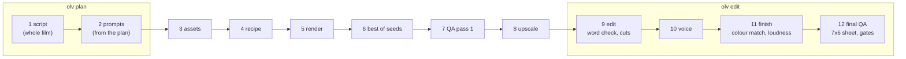

# Required flow

Every video made with this repo follows these 12 steps, in this order. A step is done only when its gate passes.
Results in this repo come from this flow. Skip a step and the numbers here no longer apply to your video.

Status words: **automated** = a repo command runs it. **partly** = the repo gives the check or library, you run the rest. **manual** = the repo has no command for it yet; you do it yourself. No command below is invented.
Reference numbers are our single runs (n = 1) on one 24 GB RTX 4090; see [EXPERIMENTS.md](EXPERIMENTS.md) and [PERFORMANCE.md](PERFORMANCE.md).

The planner wraps steps 1-2 and the editor wraps steps 9, 11 and 12 ([PLANNER.md](PLANNER.md), [EDITOR.md](EDITOR.md)). The numbering stays 1-12, so older run manifests and checklists still read the same. Both pick their rules from a scenario profile (`configs/profiles/`): talking_head, tutorial, podcast, cinematic_short, ad, documentary.

| # | Step | Status | Command or config | Pass gate | Reference |
|---|---|---|---|---|---|
| 1 | Script | automated | `olv plan <script> --profile <name> --facts <facts.yaml> --out plan/` (whole film, one pass) | Planner gates G1-G7 and G2F pass: claims agree with the fact sheet, no fake actions (stutter, cough, filler, self-correction, fake stop), no repeated sentence, words per clip inside the profile band (talking head 2.8-3.1 words/s from 0.3 s to S - 1.7 s; no word after 14.5 s in a clip of 15 s or less), angle changes and gesture budget inside the profile. | 3-min demo script: 6 fake actions auto-fixed, one clip 4 words short (caught before rendering) |
| 2 | Prompt | automated | `olv plan` writes `prompts/clipN.txt` from the plan and lints each (`olv lint` runs the same check) | G7: every prompt lint clean (at most 600 words, balanced `<d>` tags, rate). Framing, framing picture and gesture wording come from the plan, not from the previous clip. | `configs/prompts/podcast_host.txt`: 482 words, lint clean |
| 3 | Assets | manual | Generate and upload to ComfyUI `input/`; name them in `voice_ref` and `image_refs` | A FLUX look image of about 720p, an empty set plate with no person, a voice reference you own. | none in this repo |
| 4 | Recipe | automated | `configs/flow.default.yaml`; inspect with `olv graph configs/flow.default.yaml --out graph.json` | FastH3 Omni int8 on the card graph. Guidance 1.0, Euler, 8 steps. Identity LoRA 0.8 (`identity_strength`, needs `models.identity_lora`), realism 0.3. VSA keep 10 %. Seed 7329. | graph builds: 18 nodes, 198,136 tokens |
| 5 | Render | automated | `olv render configs/flow.default.yaml --out-dir out/` | One continuous 30 s shot, native 1280x720, 719 frames. Render time logged in `timings.jsonl`. | 604-637 s generate and decode (PERFORMANCE section 5) |
| 6 | Best of several seeds | partly | Re-render with another `seed:`; `olv wer <wav> <lines.txt> --out wer_raw.json` | WER 0 % in every 5 s window. Keep a take with 0 %. | podcast seed 7329: 0 % in all six windows; seed 7330: 4 invented words at 20.9-22.7 s |
| 7 | First QA pass | partly | Detectors in `onegpu_longvideo.qa.detectors`; `olv bgcheck <clip> <clip 1 or room plate>` (room consistency, person masked) right after each render; vision model through `onegpu_longvideo.qa.stage2` (`build_room_message` for the room) on the flagged seconds, between renders; `olv camera` | Face, hands, lip sync, motion and words are checked. The vision model sees only the flagged parts. | Stage 1 about 3.5 min per clip; stage 2 not scored on a labelled set ([QA.md](QA.md)). Per-frame feature extraction is not packaged yet |
| 8 | Upscale | automated | `olv upscale out/<name>_raw.mp4 out/<name>_1080p.mp4 ` (NVENC; `--x264` to fall back) | SPAN x2 streaming upscale to 1920x1080. | 9-20 s for 30 s |
| 9 | Edit | automated | `olv wer <clip audio> plan/prompts/clipN.lines.txt --out wer/clipN.wer.json` per clip (or `--words` with word times from another machine), then `olv edit clips/ --plan plan/plan.json --wer-dir wer/ --out edit/` | G8 every 5 s window at most 3 % WER (2+ invented words = gibberish = new take); G9 no cut inside a word; G13 sample-exact joins (each segment's audio within 10 ms of its picture). Repeats, stutters and fillers the script does not have are cut in the silence between words, 30 ms fades. | synthetic test only; see EDITOR.md |
| 10 | Voice | partly | `onegpu_longvideo.voice` (`run_converter`, `finalize`, `wer_guard`); method in [VOICE.md](VOICE.md); example `configs/voice_post.example.yaml`. No CLI yet. | Diagnose the voice (low band, 1-3 kHz honk, pitch range, voiced share, LUFS). Convert to a target chosen by those traits, at the exact original length (`len_diff` 0). Guards: WER 0 per 5 s window, lip offset within 1 frame. Final gate: a human listening A/B of 3-5 labelled candidates at equal loudness, because the metrics did not predict the listener in 2 of 3 cases. | podcast and tutor both ship a converted voice chosen by listening (tutor: 12.3 st pitch range vs 6.9 before, WER 0 in all windows) |
| 11 | Finish | automated | `olv edit` (same run) | G10 every clip within dE76 2.0 of its set-up's colour anchor, same-framing joins within 1.0 (keyframed Reinhard grade); G11 -14 LUFS +/- 1 LU and true peak at or below -2 dBTP, measured on the AAC file; x264 CRF 18, AAC 192k. | see EDITOR.md "Measured" |
| 12 | Final QA | partly | `olv edit` writes `contact_sheet.jpg` (7x6, 42 frames evenly spaced) and `edit_qa.json`; then `olv wer ... --out wer_final.json`, `olv camera`, `olv flow-check <run folder>` | G12 sheet written and reviewed by a person (`qa.contact_sheet_reviewed`), WER 0 % in every window, voice match checked, lip sync ok, generation time reported. | podcast: render 163 s + upscale 9.4 s + voice 16 s (768x432 sample) |

## Check a run

1. Copy [FLOW-CHECKLIST.md](FLOW-CHECKLIST.md) per video and tick it as you go.
2. Put `flow_run.json`, the two `olv wer --out` files, `plan.json` (from `olv plan`) and `edit_qa.json` (from `olv edit`) in one run folder. The checklist shows the exact fields. Set `"seconds"` in `flow_run.json` for clips other than 29.96 s; the frame and last-word gates follow it.
3. Run `olv flow-check <run folder>`. It prints PASS or FAIL per gate and exits 1 on any FAIL.

`flow-check` reads numbers you recorded. It does not look at the pixels. It cannot judge the human listening check, the vision review or the grade: it only refuses a missing "yes". The default gates live in `onegpu_longvideo/flow.py`.

## Notes

- Our published samples were rendered at 768x432 or 1280x720 (see the README table). `configs/flow.default.yaml` uses the native 1280x720 of step 5.
- `models.identity_lora` is empty by default. Train one only on data you have written consent to use. No weights ship here.
- One GPU job at a time. Two renders at once were 3.5x slower on our card.
