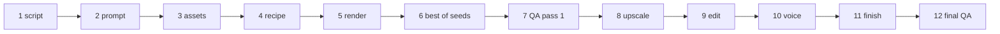

# Required flow

Every video made with this repo follows these 12 steps, in this order. A step is done only when its gate passes.
Results in this repo come from this flow. Skip a step and the numbers here no longer apply to your video.

Status words: **automated** = a repo command runs it. **partly** = the repo gives the check or library, you run the rest. **manual** = the repo has no command for it yet; you do it yourself. No command below is invented.
Reference numbers are our single runs (n = 1) on one 24 GB RTX 4090; see [EXPERIMENTS.md](EXPERIMENTS.md) and [PERFORMANCE.md](PERFORMANCE.md).

| # | Step | Status | Command or config | Pass gate | Reference |
|---|---|---|---|---|---|
| 1 | Script | partly | `olv lint <prompt> --seconds 29.96` checks the rate | Continuous speech at about 2.8-3.1 words/s. Last word by about 28.3 s. One gesture per beat. No silent gaps. | podcast: 86 spoken words in 30 s (2.9 words/s) |
| 2 | Prompt | partly | `olv lint`; build with `onegpu_longvideo.prompt.build`; examples in `configs/prompts/` | Card form, time-coded arc, no camera moves. Lint is clean (at most 600 words, balanced `<d>` tags). | `configs/prompts/podcast_host.txt`: 482 words, lint clean |
| 3 | Assets | manual | Generate and upload to ComfyUI `input/`; name them in `voice_ref` and `image_refs` | A FLUX look image of about 720p, an empty set plate with no person, a voice reference you own. | none in this repo |
| 4 | Recipe | automated | `configs/flow.default.yaml`; inspect with `olv graph configs/flow.default.yaml --out graph.json` | FastH3 Omni int8 on the card graph. Guidance 1.0, Euler, 8 steps. Identity LoRA 0.8 (`identity_strength`, needs `models.identity_lora`), realism 0.3. VSA keep 10 %. Seed 7329. | graph builds: 18 nodes, 198,136 tokens |
| 5 | Render | automated | `olv render configs/flow.default.yaml --out-dir out/` | One continuous 30 s shot, native 1280x720, 719 frames. Render time logged in `timings.jsonl`. | 604-637 s generate and decode (PERFORMANCE section 5) |
| 6 | Best of several seeds | partly | Re-render with another `seed:`; `olv wer <wav> <lines.txt> --out wer_raw.json` | WER 0 % in every 5 s window. Keep a take with 0 %. | podcast seed 7329: 0 % in all six windows; seed 7330: 4 invented words at 20.9-22.7 s |
| 7 | First QA pass | partly | Detectors in `onegpu_longvideo.qa.detectors`; vision model through `onegpu_longvideo.qa.stage2`; `olv camera` | Face, hands, lip sync, motion and words are checked. The vision model sees only the flagged parts. | Stage 1 about 3.5 min per clip; stage 2 not scored on a labelled set ([QA.md](QA.md)). Per-frame feature extraction is not packaged yet |
| 8 | Upscale | automated | Default (`upscale_in_graph: true`): already done at step 5 inside the render graph; `olv render` writes `<name>_1080p.mp4` (SPAN x2 + NVENC) and the 720p `<name>_raw.mp4` for steps 6-7, and prints `upscale_in_graph_s`. Keep the 1080p file of the take chosen at step 6. With `upscale_in_graph: false`: `olv upscale out/<name>_raw.mp4 out/<name>_1080p.mp4 ` (NVENC; `--x264` to fall back) | SPAN x2 to 1920x1080. In graph it also runs for takes that steps 6-7 later reject (~7 s each at 10 s). | 9-20 s for 30 s |
| 9 | Edit | manual | Your editor or ffmpeg | Repeated closing lines are cut. | none in this repo |
| 10 | Voice | partly | `onegpu_longvideo.voice` (`run_converter`, `finalize`, `wer_guard`); example `configs/voice_post.example.yaml`. No CLI yet. | Seed-VC conversion at the exact original length (`len_diff` 0). Keep it only if the word and lip-sync checks pass and a human listening check approves it. | podcast kept (speaker match 0.616 to 0.789); tutor rejected by ear although every metric passed |
| 11 | Finish | manual | ffmpeg | A warm colour grade, then the final encode: x264 CRF 18, AAC 192k. | none in this repo |
| 12 | Final QA | partly | `olv wer ... --out wer_final.json`, `olv camera`, then `olv flow-check <run folder>` | WER 0 % in every window, voice match checked, lip sync ok, generation time reported. | podcast: render 163 s + upscale 9.4 s + voice 16 s (768x432 sample) |

## Check a run

1. Copy [FLOW-CHECKLIST.md](FLOW-CHECKLIST.md) per video and tick it as you go.
2. Put `flow_run.json` and the two `olv wer --out` files in one run folder. The checklist shows the exact fields.
3. Run `olv flow-check <run folder>`. It prints PASS or FAIL per gate and exits 1 on any FAIL.

`flow-check` reads numbers you recorded. It does not look at the pixels. It cannot judge the human listening check, the vision review or the grade: it only refuses a missing "yes". The default gates live in `onegpu_longvideo/flow.py`.

## Notes

- Our published samples were rendered at 768x432 or 1280x720 (see the README table). `configs/flow.default.yaml` uses the native 1280x720 of step 5.
- `models.identity_lora` is empty by default. Train one only on data you have written consent to use. No weights ship here.
- One GPU job at a time. Two renders at once were 3.5x slower on our card.
