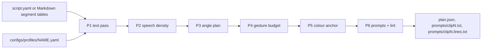

# Planner (`olv plan`, flow steps 1-2)

The planner reads the whole script once and writes one film plan before any clip prompt exists. Then it builds every clip prompt from that plan.
Rule: decode the whole, then encode the parts. A clip planned alone repeats the framing, the gestures and the grade drift of the clip before it.



## Run it

```bash
olv profiles                                    # list scenario profiles
olv plan configs/scripts/example_talking_head.yaml --profile talking_head --out plan/
olv plan SCRIPT.md --scene scene.yaml --clip-seconds 10 --profile talking_head --out plan/   # Markdown script + speaker/scene text
olv plan script.yaml --anchor-still look.png --llm --out plan/                              # colour anchor from a still; write the review request
```

Exit code 1 when a gate fails (`--no-gate` to inspect anyway). `prompts/clipN.lines.txt` is the reference text for `olv wer`.
`--llm` writes `text_review_request.md` (the whole script plus the automatic flags). With `OLV_LLM_URL` (an OpenAI-compatible endpoint), `OLV_LLM_MODEL` and optional `OLV_LLM_KEY` set, it also sends it and saves `text_review.md`. The answer is advice for the writer. It is never applied automatically.

## Script format
YAML: `title`, `clip_seconds`, `speaker` (`tag`, `role`, `language`, `voice_ref`, `description`), `scene` (`refs`, `description`, `sound`), `clips` (each: `title`, optional `seconds`, optional `side`, `lines`). See `configs/scripts/example_talking_head.yaml`.
Markdown: `## Segment N (t0-t1 s): title` followed by a table `| # | a-b | spoken line | gesture |`. The gesture column is read as a hint only and never copied into a prompt. Speaker and scene text come from `--scene`.

## Stages and gates
| Stage | What it does | Gate (plan fails when) | Rule ids |
|---|---|---|---|
| P1 text pass | Auto-fixes fake actions: stutters ("you'd, you'd"), coughs and other bracketed actions, fillers, self-corrections ("... well, nearly"), fake stops (ellipsis, dash). Flags repeated sentences (a 5-word run said twice in the film), repeated ideas across clips, weak joins between clips, digits, long lines. | G1 a banned action survives; G2 a repeated sentence | R-SP3 |
| P2 speech density | Words per clip must fit `wps` x (deadline - first word). Deadline = S - 1.7 s; for clips of 15 s or less also 14.5 s. Line times are estimated at `wps_nominal` and become the prompt time codes. Hook check: the first line should end by `hook.first_line_by_s` (warning). | G3 words outside the band (too few invites invented words; too many rushes); G4 estimated last word late | R-SP1, R-SP2, R-HK1 |
| P3 angle plan | Target changes = profile band scaled to the film length (talking head: 2-3 per 3 min). Changes only at clip joins (one locked camera per clip), at the joins with the largest topic shift, never before `min_open_clips`, at least `min_clips_between` apart, last join back to set-up A (bookend). New set-up: no last-frame chaining, use that set-up's reference still. `punch_in` mode leaves the camera and lets the editor crop. | G5 changes outside the band | R-AN1, R-AN2, R-AN3 |
| P4 gesture budget | Each gesture type has a film budget (1-2), a meaning cue (regex), and a minimum gap (40 s). At most `density` x lines in total, `max_per_clip` per clip, finger shapes capped at `finger_max`. Every other line rests. | G6 a budget or the finger cap broken | R-GE1, R-GE2 |
| P5 colour anchor | Anchor = clip 1 (default) or a still (`--anchor-still`, measured Lab mean/std). Records the gates the editor enforces. | (checked in the editor, G10) | R-CO1, R-CO2 |
| P6 prompts | One prompt per clip with `prompt.build`: references, framing picture sentence from the angle plan, speaker, scene, framing, locked camera, time-coded lines with the gesture or rest wording, end silence. Then `prompt.lint`. | G7 any lint problem | flow step 2 |

Talking head, 6 x 30 s (our 3-min demo script): set-ups A A B B C A (changes at 60, 120 and 150 s), 11 gestures in 36 lines (was 36 cues, 8 finger shapes), 6 fake actions auto-fixed, and G3 failed on clip 2 (75 words after the fixes, band 79-86): the writer adds words before any render.

## Profiles
`configs/profiles/_base.yaml` holds every key with the talking-head numbers. A profile lists only what differs.

| Profile | Speech w/s | Angles | Gestures | Editor differences |
|---|---|---|---|---|
| talking_head | 2.8-3.1 | generate, 2-3 per 3 min, bookend | 0.4 per line | jump cuts for flaws only |
| tutorial | 2.5-2.9 | punch_in, 3-6 per 3 min | 0.25, pointing x4 | punch-in 1.15, lower third, captions |
| podcast | 2.6-3.0 | generate, 1-2 per 3 min (wide, close) | 0.5 | fillers and stutters cut, lower third |
| cinematic_short | 1.2-2.8 | a new shot at every join (wide, medium, close) | 0.3 | no internal cuts |
| ad | 2.8-3.2 | a new shot at every join, hook by 3 s | 0.5 | short tail, lower third at 0.5 s, captions |
| documentary | 2.4-2.9 | 3-5 per 3 min, waist-up, close for emphasis | 0.35 | max shot 40 s, lower third |

## Limits (untested until the production test)
- Fewer gestures (0.4 per line) may change lip sync or WER. The old recipe tied one gesture to each line.
- A second camera set-up needs a reference still at that angle; identity hold at 30 degrees is untested.
- The text pass is rules plus an optional LLM review. It does not judge facts or logic by itself.
- Speech-rate bands for non-talking-head profiles come from sources and are not measured on this model yet.
