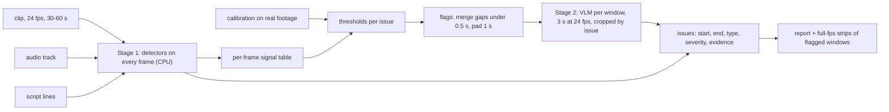

# QA

Two-stage review for long talking-head clips. Cheap detectors read every frame. A vision-language model (VLM) reads only the flagged seconds.

Status, stated plainly:

- Stage 1 is built, calibrated on real footage, and runs on every clip.
- Stage 2 is built and ready. It has not run on a scored clip. Its gain is a design claim, not a result.
- A planted-artifact recall test is designed and has not been run. Pass lines below are targets, not results.

## Why two stages

A 30 s clip is 720 frames. At about 144 tokens per cropped frame, full frame rate is roughly 100,000 tokens (est). That does not fit next to a 27B VLM in 24 GB. Reviewers therefore sample 1-2 frames per second. A hand that fuses for six frames (a quarter second) is then caught about one time in four.

In the literature we read, open VLMs score under 10 % on fine-grained artifact identification (Artifact-Bench, May 2026). So detectors must read every frame, and the VLM must see only suspect windows at full frame rate.

## Design

### Stage 1: detectors

Stage 1 runs on CPU. We ran it while the GPU rendered the next clip. About 3.5 min per 30 s clip in our notes. One logged run read 588.5 s in total.

| Issue | Detector | Notes |
|---|---|---|
| Wrong, invented or repeated words | faster-whisper (word timestamps and probabilities); WER of short windows against the script; voiced seconds with no words | the main speech check |
| Identity drift, identity jump, lost face | face-recognition score (ArcFace) on every frame, against the clip's own running median | absolute scores are not compared (see calibration) |
| Hand anomaly | hand-landmark confidence, finger-length ratios, jitter, dropout, crossing | needs two independent signs |
| Gesture repeat | pose-trajectory autocorrelation, with 2 s segment recurrence | |
| Seam, jump cut, flicker | luma and colour per frame, SSIM to previous frame, optical-flow warp error, scene detection | |
| Luma step, colour step | a step that persists over 12+ frames (a flicker returns; a step stays) | |
| Frozen motion | near-zero flow and SSIM near 1 for 6+ frames on the face box | |
| Lip-sync offset | SyncNet v2 offset and confidence per window | flag tool, not a score |
| Missing blinks | face-landmark blink rate and longest gap | report-only |

Flag types in the report: seam, jump_cut, flicker, luma_step, colour_step, identity_drift, identity_jump, face_lost, hand_anomaly, no_blink, lip_sync_offset, lip_sync_lost, gibberish_lowconf, voiced_without_words, wrong_words_vs_text, extra_or_wrong_word, gesture_repeat, frozen_motion.

Detector-only findings (WER, SyncNet offset, blink gap) stay in the report even when the VLM disagrees. The VLM cannot hear, so speech and lip-sync flags never go to it.

### Stage 2: VLM on flagged windows

- Windows come from visual flags. Flags closer than 0.5 s merge. Each gets 1 s of padding.
- A 3 s window is 72 frames, about 10,000 tokens (est).
- Each window is cropped by issue type (face, hands or full frame). Each frame carries its timestamp as text.
- The prompt includes the detector's evidence, for example "face match drop from 0.62 to 0.41 at 12.3-12.6 s".
- The VLM answers in a fixed format: confirm or reject, what it sees, exact start and end.
- Two random unflagged windows per clip go to the VLM too. They measure what the detectors miss.
- The VLM we planned to use: Qwen3.8-27B (Apache-2.0 on its model card), served through llama.cpp with frames as images. Estimated 17.9 GB at 8k context, about 19.5 GB at 24k, about 2-3 min per 30 s clip plus load (all est). It refuses to start while the GPU is busy.
- Challenger (untested): Qwen3.5-9B Q8_0, about 2.5x faster (est), near-equal MVBench on its card (74.4 vs 75.5).
- The reviewer then reads full-fps strips of flagged windows, not 1 fps sheets of the whole clip.

## Thresholds we used

The values below come from one flags report on a 30 s clip, with limits calibrated on real footage. They are starting points. Recalibrate on your own speaker and scene.

| Flag | Signal | Threshold | Real-footage range |
|---|---|---|---|
| identity_drift | ArcFace drop vs running median | 0.12 | -0.024 to 0.085 |
| extra_or_wrong_word | word not in script, word probability | below 0.6 | - |
| hand_anomaly | criteria hit (bone-length deviation, landmark jitter, hand dropout, hands crossing) | 2 criteria | hand score 0.54-1.00; tip ratio 0.30-1.57; jitter 0.02-4.87 |
| luma_step | persistent luma step | 5.0 | 0.003 to 2.75 |
| gesture_repeat | pose-trajectory correlation | 0.908 | up to 0.898 |

Other settings:

- Gesture events: the 90th percentile on real footage was 9 events per minute, so that became the gesture threshold.
- Merge gap 0.5 s, padding 1 s.
- SyncNet design: 1 s windows, step 0.25 s, plus or minus 15 frames.
- Severity labels are low, medium and high.

Example report (30 s clip, 719 frames): 7 flags (14 per minute), 86 words heard, WER 0.024, SyncNet global offset -40 ms, blink rate 22 per minute (real segments: 18, 36, 20, 26). Flags: low identity drift at 2.7 s, low extra word at 9.2 s, medium hand anomaly at 11.5 s, medium and low luma steps at 14.1 s and 15.0 s, medium hand anomaly at 20.8 s, medium gesture repeat at 22-24 s. Stage 1 found three defects we had missed by eye on our best earlier clip: an invented word at 9.2 s, a light jump at 14.1 s and crossed hands at 20.8 s.

## Calibration notes

- Calibration used 4 segments of held-out real footage of the speaker. The held-out video was never used for training.
- Absolute face match is not comparable. Generated footage scored about 0.55-0.64 against about 0.92 for real footage. Drift is measured against the clip's own median.
- **Two detectors failed calibration and are report-only:** the lip-sync offset estimator could not recover shifts we added on purpose, and the blink rule did not separate real from generated footage.
- SyncNet is a flag tool. In the literature we read (THEval), sync scores correlate poorly with human ratings (r -0.16 and -0.27). Our own "sync" metric measured delay, not coupling, so we retired it as a gate.
- A hand flag fires on real footage about twice per minute. Treat hand flags as prompts for a look, not as verdicts.
- Thresholds from real footage come from a small sample. A different speaker, camera or lighting needs new ranges.
- Before trusting a gate, run it on real clips and on clips with planted defects.

## Planned deciding test (not run)

Plant 12 artifacts at random times in a good clip: one-frame luma flicker (+12 %), 3-frame freeze, 1 s loop, 0.5 s face swap from another take, hard splice, +160 ms audio shift for 3 s, 2 s reversed audio, bad-hand frames pasted from a failed clip, 8 px background shift for 1 s, persistent +20 % luma step, 5 s frozen eye region, 0.5 s whole-frame warp.

Arms: (0) contact-sheet review at 1-2 fps; (1) stage 1 only; (2) stage 1 + 27B VLM; (3) stage 1 + 9B VLM.

Score: recall per class within 0.5 s, false flags per minute on the clean clip, timestamp error, time per 30 s.

Target pass line: recall at least 90 % on planted artifacts, at least 80 % on real issues, at most 2 false flags per minute. A VLM arm earns its place only if it raises recall or cuts false flags against stage 1 alone.

## Voice post step guard

After Seed-VC conversion the pipeline applies two hard guards before it accepts the audio:

1. **Sample-exact length.** The output is trimmed or padded to the exact input sample count. Every output in our tests matched the input (2,877,440 samples for a 60 s test) and every AAC track decoded back from the muxed file matched too.
2. **WER guard.** WER is recomputed on every cut. Gates we used: speaker match up at least +0.03 and WER up at most +2 points. Seed-VC v1 met both (+0.033; +1.7 points on a 60 s test). On the joined 56 s cut WER stayed at 0.56 %.

Also checked: envelope lag between -8 and +6 ms with no drift, and SyncNet offset unchanged before and after.

DNSMOS fell slightly (3.50 to 3.43 on the joined cut). No metric here measures "robotic" directly. A blind listening test is still needed.
