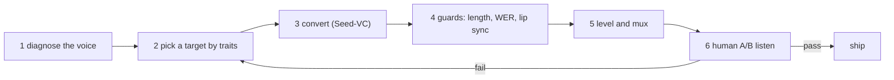

# Voice post: how to make a generated voice better

This page records the method, not one voice. Use it to lift a weak generated voice next time and to choose a better one, not an identical one.
All numbers are our single runs (n = 1) on a 30 s tutor sample, CPU for the voice tools. Step 10 of [FLOW.md](FLOW.md) points here.

## 1. Diagnose before you convert

A native model voice that sounded bad to listeners had a clear signature. Measure these on 30 s of the speech, on your voice and on one voice you accept:

| Measure | How | Bad voice | Accepted voice |
|---|---|---|---|
| Loudness | LUFS-I (ffmpeg `ebur128`) | -23.0 | -19.4 |
| Energy below 300 Hz | share of spectral energy | 8 % | 25 % |
| Energy 1-3 kHz ("honk") | share of spectral energy | 29 % | 12 % |
| Pitch spread | SD of F0 in semitones | 2.55 | 3.63 |
| Pitch range | F0 p5-p95 in semitones | 6.9 | 11.8 |
| Voiced-frame share | pyin voiced frames / all | 0.25 | 0.55 |
| Speaking rate | words per minute | 186 (3.1 words/s) | n/a |

Reading it:
- Little energy below 300 Hz plus a strong 1-3 kHz band sounds thin and boxy.
- A narrow pitch range and a low voiced share sound flat and buzzy.
- The model copies its voice reference. A reference with the same thin shape gives a thin result, so diagnose the reference too (ours had 36 % at 1-3 kHz).
- Low loudness (-23 LUFS) makes any voice feel worse. Fix level last, with gain only.
- Rate cannot be changed without breaking lip sync. Fix it in the script (step 1 of the flow).
- Bitrate was not the cause: AAC 192k at 48 kHz was fine. Noise floor, clipping and hum were clean.

## 2. Choose the conversion target by traits

Pick a stock or consented voice that fixes the measured faults. Do not copy a real person.
- Lively and warm: energy below 300 Hz near 15-25 %, 1-3 kHz near 12-20 %.
- Natural and wide pitch: F0 SD of 3.5 st or more, range of 11 st or more.
- Clean recording: no noise floor in pauses. A quiet, noisy target copies that flaw (one candidate did: noise floor in pauses at -56 dB, a pitch far deeper than the face).
- Different per character. Give each character its own target so two characters never share a voice.
- Target clip: 10-15 s of clean speech, a few emotions joined with 0.3 s gaps (neutral first). Only a voice you own, a public stock voice, or one with written consent. Never clone a real person without consent.

## 3. Seed-VC settings used for the picked candidate

| Setting | Value |
|---|---|
| Model | Seed-VC v1 (DiT, Whisper-small, BigVGAN) |
| Source | the generated speech, 48 kHz, whole clip |
| Target | one stock male voice, 11 s (designed + neutral + happy clips joined) |
| Diffusion steps | 50 |
| `inference-cfg-rate` | 0.7 |
| `length-adjust` | 1.0 |
| F0 condition | off |
| fp16 | off |
| Device | CPU |

Output is 22 kHz, so nothing above 11 kHz. Resample to 48 kHz and match the length (next section).

## 4. Guards (all must pass before a listen)

| Guard | Rule | Result for the picked candidate |
|---|---|---|
| Sample-exact length | decoded audio has exactly the original sample count (`match_length`) | 1,437,696 samples, equal to the original |
| Words | WER 0 in every 5 s window (`olv wer`) | 0 in all six windows |
| Lip sync | SyncNet offset within +-1 frame at 25 fps on 3 windows | -1 / -1 / 0 |
| Envelope lag | 10 ms RMS envelope lag near 0 ms (`envelope_lag_ms`) | -1 ms (range -7 to 3) |
| Loudness | gain only, same target for every candidate and for your other videos | final -12.6 LUFS to match the podcast sample |

Mux with the video stream copied and AAC 192k 48 kHz: `ffmpeg -i video.mp4 -i voice.wav -map 0:v -map 1:a -c:v copy -c:a aac -b:a 192k -ar 48000`. Check the video stream hash is unchanged. If the gain pushes a peak over 0 dBFS, add a limiter (`alimiter`) and re-measure.

## 5. The final gate is a human listen

The metrics (speaker match, DNSMOS, WER, sync) did not predict the listener in 2 of 3 cases: a candidate that passed every guard was rejected by ear.
So the last step is manual:
1. Build 3-5 labelled candidates (A, B, C, ...), including the unchanged original as one of them.
2. Cut the same 15 s span for each. Same video, same loudness (-16 LUFS, gain only).
3. Listen on the device your audience uses. Pick one. Write down the pick.
4. `olv flow-check` refuses a missing "yes" here.

Candidates worth trying, one change each: tone EQ only, an enhancer only, a conversion to target X, a conversion to target Y. Combine only after a pick (for example conversion, then EQ).

## 6. Config

`configs/voice_post.example.yaml` holds the converter command, the target, the Seed-VC settings above and the guards.
Replace the target with your own consented or stock voice.
